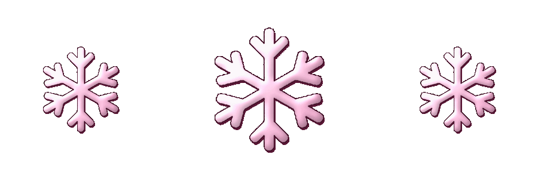
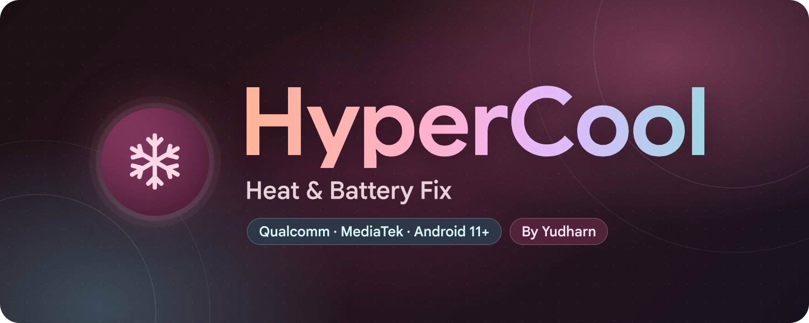

## About

  

### I'm Yudharn. I build Android kernels mostly for POCO F5 (Marble) and KernelSU / Magisk Modules

## Projects

**[HyperCool](https://github.com/yudharn/HyperCool)** — KernelSU / Magisk module that reduces heat and battery drain on Android.

**[POCOF5-Melt-Rebase-Kernel-Marble](https://github.com/yudharn/POCOF5-Melt-Rebase-Kernel-Marble)** — Melt Rebase kernel for the Redmi Note 12 Turbo / POCO F5.

**[OrengeFox-For-Marble](https://github.com/yudharn/OrengeFox-For-Marble)** — OrangeFox recovery for the Redmi Note 12 Turbo / POCO F5.

**[Porting-HyperOS-Marble](https://github.com/yudharn/Porting-HyperOS-Marble)** — HyperOS ROM porting for marble.

## Contact

  
  &nbsp;
  

Bug reports go in the Issues tab of each repo.

---
## My Project HyperCool

  

  KernelSU / Magisk module for Qualcomm &amp; MediaTek — less heat, less battery drain, longer battery life.

  
  &nbsp;
  
  &nbsp;
  

  
  &nbsp;
  

